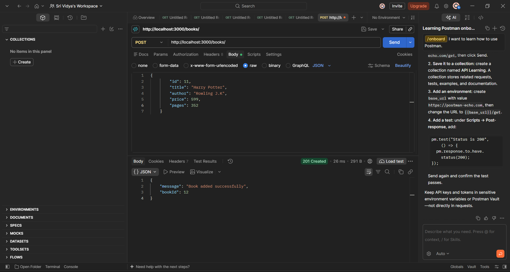
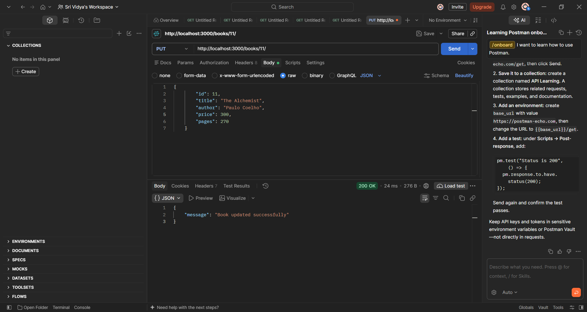
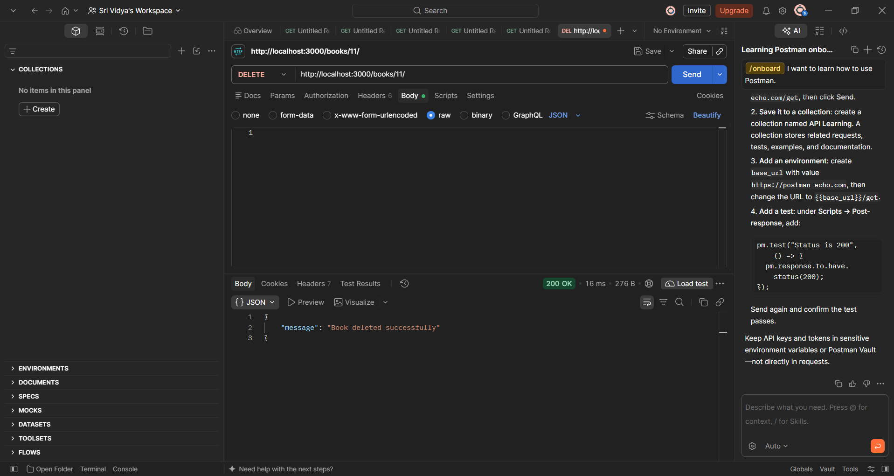
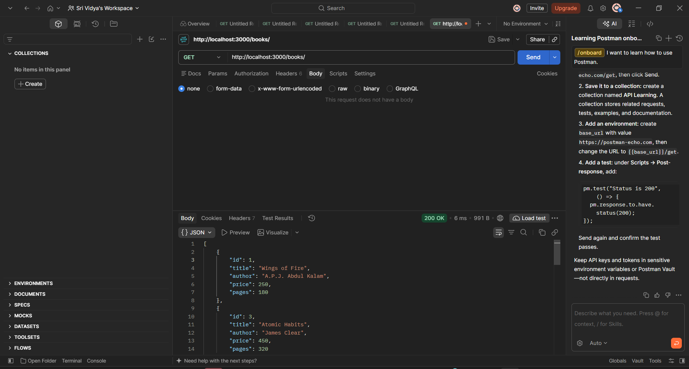

# Lab 2: Books CRUD API Using Node.js, Express, and SQLite

## Student Details

- **Name:** AMARA SRI VIDYA
- **Registration Number:** 252U1R9007
- **Section:** CSE GEN AI - 2A 
- **Course:** Backend Development Fundamentals
- **Lab Number:** 02

## Live Deployment

<YOUR RENDER LINK>

## Objective

To develop a RESTful Books API using Node.js, Express.js, and SQLite to perform CRUD (Create, Read, Update, and Delete) operations on book records.

## Technologies Used

- Node.js
- Express.js
- SQLite
- JavaScript
- npm
- Postman
- Visual Studio Code
- Git and GitHub
- Render (deployment)

## Project Structure

```text
Lab_02/
├── screenshots/
│   ├── DELETE.png
│   ├── ERROR.png
│   ├── GET_ALL.png
│   ├── GETONE.png
│   ├── POST.png
│   └── PUT.png
├── .gitignore
├── app.js
├── books.db
├── books.sql
├── package.json
├── package-lock.json
└── README.md
```

## Installation and Setup

### Prerequisites

- Node.js and npm
- Visual Studio Code
- Postman
- Git

### Steps to Run

1. Clone the repository or download the project.
2. Open the `Lab_02` folder in the terminal.
3. Install the dependencies:

   ```bash
   npm install
   ```

4. Start the development server:

   ```bash
   npm run dev
   ```

5. Test the API in Postman using:

   ```text
   http://localhost:3000
   ```

## Database

- `books.db` is the SQLite database file, created automatically when the server starts.
- `books.sql` contains the SQL statements for the 10 sample books.
- The `book` table has the columns: `id`, `title`, `author`, `price`, `pages`.

## API Endpoints

| Method | Endpoint | Description | Expected Status |
|---|---|---|---|
| GET | `/books/` | Retrieves all books | 200 OK |
| GET | `/books/:bookId/` | Retrieves a book by its ID | 200 OK |
| POST | `/books/` | Adds a new book | 201 Created |
| PUT | `/books/:bookId/` | Updates an existing book | 200 OK |
| DELETE | `/books/:bookId/` | Deletes a book by its ID | 200 OK |

Sample request body for POST and PUT:

```json
{
  "title": "My Book",
  "author": "Author Name",
  "price": 300,
  "pages": 200
}
```

## Screenshots

### 1. GET All Books


### 2. GET a Single Book


### 3. POST a New Book


### 4. PUT an Existing Book


### 5. DELETE a Book


### 6. Error Handling (404 Not Found)


## CRUD Operations

- **Create:** Adds a new book using POST.
- **Read:** Retrieves all books or one book using GET.
- **Update:** Modifies an existing book using PUT.
- **Delete:** Removes a book using DELETE.

## HTTP Status Codes

- **200 OK:** The request was successful.
- **201 Created:** A new resource was created successfully.
- **400 Bad Request:** The request contains invalid input.
- **404 Not Found:** The requested book does not exist.
- **500 Internal Server Error:** An unexpected server error occurred.

## Problems Faced and Solutions

- **Problem:** `npm init -y` failed in PowerShell with the error "running scripts is disabled on this system".
  **Solution:** I ran `Set-Executionpolicy -Scope CurrentUser -ExecutionPolicy RemoteSigned`, which allowed npm scripts to run.

## Git and Repository Notes

- The `.gitignore` file excludes `node_modules/` and `.env`.
- The `node_modules/` directory is not committed.
- Screenshots are stored in the `screenshots/` directory.

## Conclusion

The Books CRUD API was developed using Node.js, Express.js, and SQLite. It supports creating, retrieving, updating, and deleting book records, and all operations were tested using Postman.